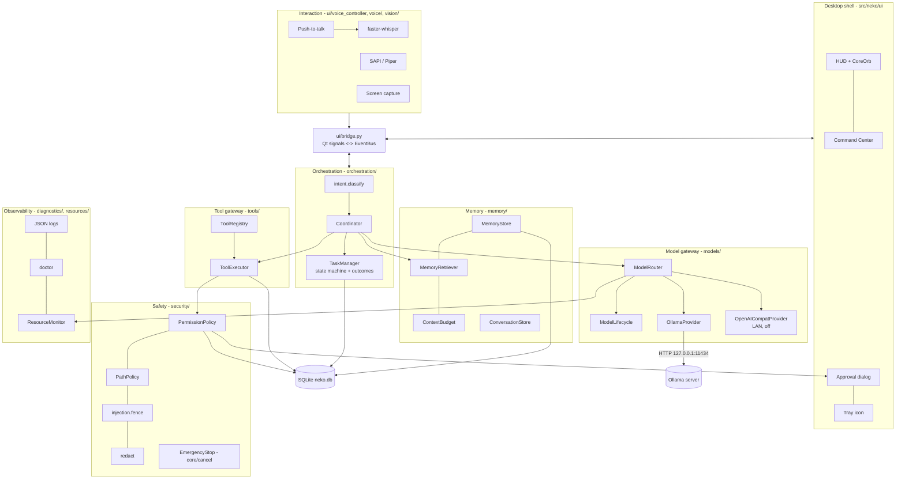

# Architecture

## 1. Decisions in one table

| Decision | Choice | Why |
|---|---|---|
| Language | Python 3.11–3.13 (3.14 works for the core) | One language for UI, orchestration, voice, automation; best local-AI ecosystem |
| UI | PySide6 (Qt 6), single process | Native frameless/translucent windows, no browser runtime, LGPL |
| Model runtime | Ollama (already installed) over its localhost REST API | Proven on this GPU; handles GGUF, offload, unload |
| Storage | SQLite (WAL) + FTS5, one file | Zero-admin, transactional, built into Python |
| Vector search | float32 BLOBs + Python cosine | Enough for ≤10k memories; no pre-v1 extension |
| Agent framework | Custom coordinator (no LangGraph/AutoGen) | Small, auditable; small models can't use complex agent loops reliably |
| Process model | One process; worker threads; one inference at a time | 4 GB GPU — concurrency would only thrash memory |
| Core dependencies | **None** (stdlib only) | Smaller attack surface; tests run without installing anything |

## 2. Layers and packages



| Package | Responsibility | Key types |
|---|---|---|
| `core` | shared types, errors, cancellation, events | `CancelToken`, `EmergencyStop`, `EventBus`, `AssistantState`, `RiskLevel` |
| `configuration` | defaults + user TOML, validation, safe save | `Settings`, `load_settings`, `save_user_overrides` |
| `database` | connections, migrations, backup/restore/verify, audit | `Database` |
| `memory` | memories, provenance, retrieval, context budget, conversations | `MemoryStore`, `MemoryRetriever`, `ContextBudget`, `ConversationStore` |
| `models` | provider protocol, Ollama + OpenAI-compatible adapters, profiles, router, lifecycle, disk inventory | `ModelProvider`, `ModelInfo`, `ModelRouter`, `ModelLifecycle` |
| `resources` | RAM/CPU/GPU/battery/disk probes, feasibility | `ResourceMonitor`, `ResourceSnapshot`, `assess` |
| `security` | permission policy, approvals, path rules, redaction, injection fencing | `PermissionPolicy`, `ApprovalRequest`, `PathPolicy` |
| `tools` | tool specs, validation, executor, built-in tools | `ToolSpec`, `ToolRegistry`, `ToolExecutor`, `ToolResult` |
| `orchestration` | intent, prompts, coordinator, tasks/outcomes | `Coordinator`, `TaskManager`, `Intent` |
| `agents` | specialist role registry and boundaries | `AgentSpec`, `AGENTS` |
| `voice` | STT/TTS/wake word interfaces + adapters | `SpeechRecognizer`, `SpeechSynthesizer`, `WakeWordDetector` |
| `vision` | image preparation/tiling | `prepare_png`, `tile_boxes` |
| `diagnostics` | logging setup, doctor | `configure_logging`, `run_checks` |
| `app` | composition root | `build()`, `Neko` |
| `ui` | PySide6 shell | `HudWindow`, `CommandCenter`, `CoreOrb`, `UiBridge` |

## 3. Component contracts

The requested contracts map to code as follows (signatures live in the files named):

| Contract | Where | Notes on errors / cancellation / timeouts |
|---|---|---|
| `ModelProvider` | `models/base.py` | `health()`, `list_models()`, `loaded_models()`, `chat_stream(req, token)`, `chat()`, `embed()`, `unload()`. Raises `ModelUnavailableError` / `ModelTimeoutError` / `CancelledError`. Stream checks the token between chunks and closes the socket when it's cancelled. |
| `ModelCapability` | `core/types.Capability` + `ModelInfo.capabilities` | chat, reasoning, coding, vision, embedding, tools |
| `TaskPlanner` | `agents/registry.py` "planner" role + `orchestration/prompts.py` | v0.1: the planner is a prompt role on the reasoning model, not a separate loop |
| `ToolRegistry` / `ToolExecutor` | `tools/base.py` | Schema validation → policy → approval → run on a thread with a child token and a timeout → verifier → audit. Timeout returns "may have partially completed". |
| `PermissionPolicy` | `security/policy.py` | `evaluate()` is pure; `request_approval()` blocks the worker thread until the UI resolves, the token is cancelled, or 300 s pass (then denied) |
| `MemoryStore` | `memory/store.py` | Transactional writes; duplicates reinforce; edits version |
| `EmbeddingProvider` | `models/base.py` | Optional; retrieval degrades to lexical on any error |
| `SpeechRecognizer` / `SpeechSynthesizer` / `WakeWordDetector` | `voice/base.py` | `available()` returns (ok, reason). Missing deps raise `PeripheralUnavailableError` with an install hint. `speak()` stops on token cancel. |
| `VisionProvider` | Any `ModelProvider` whose model has `Capability.VISION` (images go in `ChatMessage.images`) | |
| `ResourceMonitor` | `resources/monitor.py` | Cached ≤3 s; unknown sensors → `None` |
| `TaskQueue` | `ui/bridge.py` (single worker, rejects concurrent sends) + `ModelLifecycle.lock` | Deliberately depth 1 |
| `OutcomeVerifier` | `ToolSpec.verifier` + `TaskManager.record_outcome` | Evidence rows in `verification_evidence` |
| `AuditLogger` | `Database.audit()` → `audit_events` | Arguments redacted |

## 4. Request flow

```mermaid
sequenceDiagram
  participant U as You
  participant UI as HUD / CLI
  participant C as Coordinator
  participant R as Router
  participant M as Memory
  participant O as Ollama
  participant T as ToolExecutor
  participant P as Policy
  U->>UI: "summarise D:\Notes\plan.md"
  UI->>C: handle(text, token)
  C->>C: classify -> QUESTION; create task
  C->>R: route(kind, resources)
  R-->>C: llama3.2:3b (reason, candidates)
  C->>M: retrieve(text, budget)
  C->>O: chat_stream(system+memories+history+text)
  O-->>C: <tool_call>{"tool":"read_text_file",...}
  C->>T: run(read_text_file, args, tainted=false)
  T->>P: evaluate(level 0) -> allow
  T-->>C: file text (fenced UNTRUSTED)
  C->>O: chat_stream(... + tool result)
  O-->>UI: streamed summary tokens
  C->>C: persist messages, outcome, routing result
```

If the next tool call has risk ≥1 while untrusted content is in context (this turn or the 3 turns
before it), the policy escalates it to an approval dialog.

## 5. Data locations

| What | Where |
|---|---|
| Source code | `D:\PROJECT\N.E.K.O` |
| Python environment | `D:\PROJECT\N.E.K.O\.venv` (created by setup) |
| User config | `%LOCALAPPDATA%\NEKO\config.toml` |
| Database | `%LOCALAPPDATA%\NEKO\neko.db` (+ `-wal`, `-shm`) |
| Logs | `%LOCALAPPDATA%\NEKO\logs\neko.log.jsonl` (rotating) |
| Backups | `%LOCALAPPDATA%\NEKO\backups\` |
| LLM weights | `D:\Ollama\models` (Ollama-managed; N.E.K.O. reads manifests only) |
| Speech models | faster-whisper cache (Hugging Face cache dir), Piper voice files wherever you put them |

## 6. Threading model
- GUI thread: Qt only.
- One request worker thread at a time (`UiBridge.send` refuses a second one).
- Tool handlers run on a 2-thread pool with per-call timeouts.
- STT and TTS each use their own short-lived thread.
- Resource polling and health checks run on short-lived threads every 5 s / 15 s.
- SQLite: one connection per thread, WAL, `busy_timeout` 10 s, writes serialised by a lock.

## 7. Optional second computer (designed, partially built)
- The desktop runs Ollama bound to localhost, with a TLS reverse proxy (e.g. Caddy) on a LAN address
  that requires a bearer token. No port forwarding on the router, and the firewall rule is limited to
  the laptop's IP.
- The laptop adds `[[remote.endpoints]]` (HTTPS, private IP enforced by config validation), with the
  token in an environment variable.
- The router only uses it when `remote.enabled`, never for requests classified as sensitive, and
  shows `LAN:<name>` in the HUD.
- **Not yet built:** proxy setup guide automation, certificate pinning (`ca_file` is supported in
  the adapter but not exposed in config), and capability health checks. See ROADMAP.

## 8. Failure handling summary
| Failure | Behaviour |
|---|---|
| Ollama not running | HUD → OFFLINE state; replies explain `start-ollama.ps1` |
| Model not installed | Router explains the candidates; no download |
| Not enough memory | Candidate rejected with numbers; fallback role tried |
| Model timeout | Task failed with "took too long"; partial text kept |
| Tool error/timeout | Reported to the model and the user; invocation logged |
| Approval timeout (300 s) | Treated as denied |
| Embedding failure | Lexical retrieval only |
| Voice deps missing | Mic button explains what to install |
| DB migration failure | Rolled back; a pre-migration backup exists |
